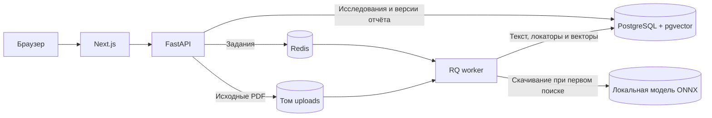

# Контур

Локальное рабочее пространство для исследования вопроса по документам и ссылкам. Создайте исследование с вопросом, добавьте текстовый PDF или ссылку на публичную HTML-страницу и получите отчёт, из которого можно перейти к точной цитате и сравнить расхождения между источниками.

## Локальный запуск

Понадобится Docker с Compose v2 и поддержкой Linux-контейнеров. При первой сборке нужен доступ к реестрам образов и пакетов.

Склонируйте репозиторий и перейдите в каталог проекта.

```sh
git clone https://github.com/vittedone/contour.git
cd contour
```

1. В PowerShell выполните `Copy-Item .env.example .env`. В Linux или macOS используйте `cp .env.example .env`.
2. Откройте `.env` и задайте собственное непустое значение `POSTGRES_PASSWORD`. При необходимости измените `WEB_PORT` и `API_PORT`.
3. Соберите и запустите сервисы.

```sh
docker compose up --build -d --wait
docker compose ps
```

При стандартных портах откройте [рабочее пространство](http://localhost:3000). [Статус API](http://localhost:8000/health) возвращает `{"status":"ok"}`, когда доступны PostgreSQL и Redis. Порты интерфейса и API привязаны к loopback. Redis и база доступны по именам сервисов только внутри Compose.

Для просмотра журналов выполните `docker compose logs -f`. Для остановки используйте `docker compose down`. Именованные тома сохраняются при остановке. После изменения кода повторите команду сборки и запуска.

## Демонстрация за две минуты

После запуска откройте [рабочее пространство](http://localhost:3000) и нажмите **«Открыть демоотчёт»**. Учебное исследование посвящено времени поездки после открытия выделенной полосы. Три вымышленных источника подготовлены специально для демонстрации.

1. В отчёте перейдите к разделу **«Возможные противоречия»**. Сводка диспетчерской и контрольные рейсы дают оценку сокращения времени на **18 %**, дневник пассажиров — на **8 %**.
2. Откройте ссылку под цитатой из дневника. Выделенный текст показывает оценку, а соседнее предложение поясняет, что пассажиры включили ожидание на остановке. Вернитесь в отчёт через историю браузера и откройте вторую позицию.
3. В разделе **«Тезисы и свидетельства»** откройте обе ссылки под утверждением о 18 %. Это одинаковая формулировка в двух разных снимках. В разделе **«Пробелы и ограничения»** видно, почему сравнение требует проверки условий измерения.

API устанавливает демо и первую версию отчёта одной транзакцией при старте. На чистой базе пример появляется автоматически, на существующей — один раз. Снимки, границы цитат и заранее рассчитанная подборка находятся в `api/demo_materials.json`. Первоначальный показ работает без скачивания модели. Кнопка обновления поиска использует обычный worker и текущие настройки модели.

## Архитектура



## Состав проекта

| Сервис | Назначение |
| --- | --- |
| web | Next.js и TypeScript. Русскоязычные страницы обзора и источников. |
| api | FastAPI. При старте применяет миграции и подключается к Redis. |
| postgres | PostgreSQL 16 с расширением pgvector. Данные хранятся в томе `pgdata`. |
| redis | Брокер очереди. Внутренний адрес задаётся через `REDIS_URL`. |
| worker | Python-процесс RQ обрабатывает источники в очереди `contour`. |

## Данные и настройки

Начальные имя базы, пользователь и пароль PostgreSQL берутся из `.env` при создании тома. Для существующей базы смену учётных данных нужно согласовать с изменениями внутри PostgreSQL. API получает параметры соединения через переменные окружения.

SQL-миграции находятся в `api/migrations`. API выполняет их по имени файла в одной транзакции под блокировкой PostgreSQL и записывает применённые имена в `schema_migrations`. Первая миграция включает расширение `vector`. Для изменения схемы добавляйте новый нумерованный SQL-файл.

Том `uploads` смонтирован в API и worker по адресу `/data/uploads` для хранения исходных PDF. Локальные файлы окружения, каталоги `uploads/` и `secrets/`, PDF и файлы закрытых ключей исключены из Git.

## Обработка источников

API сохраняет запись источника в PostgreSQL. Диспетчер отправляет её в очередь RQ. Worker извлекает текст и одной транзакцией сохраняет разделы, фрагменты и статус готовности. Если Redis потеряет задание или worker остановится, диспетчер повторно передаст источник после истечения трёхминутного срока. После трёх прерванных попыток источник получает статус ошибки.

| Переменная | По умолчанию | Ограничение |
| --- | --- | --- |
| MAX_PDF_MB | 16 | Размер одного PDF в МиБ |
| MAX_PDF_PAGES | 500 | Число страниц PDF |
| MAX_WEB_MB | 4 | Размер HTML-ответа в МиБ |

Worker загружает публичные HTML-страницы по HTTP или HTTPS. Он проверяет разрешённые DNS-адреса перед каждым соединением, включая перенаправления, и соединяется с проверенным IP. Загрузка выполняется без JavaScript. PDF должен содержать текстовый слой.

Исходный PDF хранится под UUID в томе uploads. Для веб-страницы сохраняются исходный и конечный URL, HTML-снимок и текст по разделам. Каждый фрагмент ссылается на страницу PDF или раздел снимка и хранит полуоткрытый диапазон символов в сохранённом тексте. Позиции в базе начинаются с нуля, в интерфейсе — с единицы. Текст цитаты извлекается из этого снимка. Новые форматы подключаются через реестр EXTRACTORS в worker/extract.py.

## Поиск фрагментов и черновые тезисы

В разделе источников выберите исследование и нажмите «Найти фрагменты и тезисы». Worker берёт готовые источники на момент начала поиска, включая материалы, добавленные до обновления. После добавления новых источников нажмите «Обновить результаты». Повторный запуск использует уже сохранённые векторы.

При первом поиске worker скачивает файлы модели sentence-transformers/paraphrase-multilingual-MiniLM-L12-v2 с Hugging Face. Для загрузки нужен интернет и около 500 МБ свободного места в томе models. Дальнейшее кодирование текста и вопроса выполняется локально на CPU. Ревизия модели закреплена в worker/embeddings.py. При смене модели потребуется пересчитать сохранённые векторы.

PostgreSQL с pgvector ранжирует фрагменты внутри выбранного исследования по косинусному сходству с вопросом. Отбирается до 12 фрагментов. Из них worker выбирает до пяти дословных формулировок с привязкой к диапазону символов сохранённого текста. Ссылка под тезисом открывает фрагмент с выделенной цитатой. Близость к вопросу служит критерием отбора и не оценивает достоверность утверждения.

MIN_SIMILARITY задаёт минимальное косинусное сходство для фрагментов и предложений (по умолчанию 0.30). EMBEDDING_THREADS задаёт число потоков CPU для модели (по умолчанию 2). Задание выполняется в существующей очереди RQ, поэтому первая загрузка модели может задержать другие задания.

## Противоречия и отчёт

Откройте «Отчёт исследования» на странице источников после семантического поиска и нажмите «Сформировать отчёт». Краткий ответ извлекается из наиболее релевантных тезисов. Для каждого свидетельства доступен сохранённый фрагмент с выделенной цитатой и расположением в источнике.

Приложение сопоставляет черновые тезисы с полными предложениями из найденных фрагментов других источников. Совпадающие формулировки показываются как дополнительные свидетельства. При одинаковом контексте проверяются явное отрицание, противоположное направление изменения и различие чисел с одной единицей измерения. Обе позиции отображаются рядом для проверки пользователем. Правила ограничены близкими формулировками на русском языке. Пустая подборка, единственный источник и расхождения отражаются в ограничениях отчёта.

После обновления поиска нажмите «Обновить по результатам поиска». Изменённый отчёт сохраняется как новая версия в PostgreSQL. Предыдущие версии доступны через переключатель. Повторное формирование по тем же данным возвращает существующую версию.
