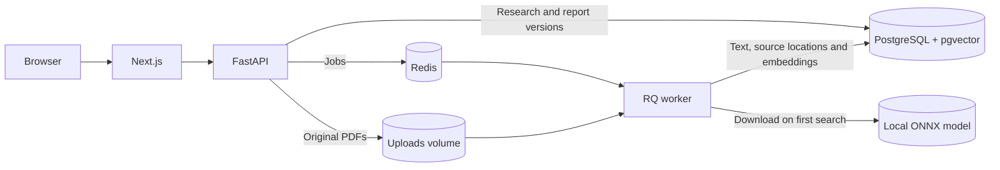

# Contour

Contour is a local research workspace for comparing evidence from PDFs and public web pages. Start with a question, add sources, and generate a report. Each claim links to a highlighted passage on a PDF page or in a saved web section, so you can read competing accounts in context. The application interface and sample research are in Russian.

## Run locally

Install Docker with Compose v2 and Linux container support. The first build needs internet access to download images and packages.

```sh
git clone https://github.com/vittedone/contour.git
cd contour
```

1. Copy the environment template. Use `Copy-Item .env.example .env` in PowerShell or `cp .env.example .env` on Linux and macOS.
2. Set a nonempty `POSTGRES_PASSWORD` in `.env`. Set `WEB_PORT` and `API_PORT` if you need different ports.
3. Build and start the services from the repository root.

```sh
docker compose up --build -d --wait
docker compose ps
```

With the default ports, open the [workspace](http://localhost:3000). The [API health endpoint](http://localhost:8000/health) returns `{"status":"ok"}` when PostgreSQL and Redis are reachable. The web and API ports bind to the loopback interface. PostgreSQL and Redis are accessible inside the Compose network.

Use `docker compose logs -f` to follow the logs and `docker compose down` to stop the stack. Named volumes retain your data. After a code change, run the build and start command again.

## Two-minute demo

Open the workspace and select **Open demo report** («Открыть демоотчёт»). Three fictional sources describe how journey times changed after a dedicated bus lane opened.

1. In **Possible contradictions** («Возможные противоречия»), compare the estimates. The dispatch log and the observer's notes report an **18%** reduction in journey time. The passenger diary reports **8%**.
2. Follow the citation beneath the diary entry. The highlighted sentence contains the estimate. The next sentence explains that passengers included time spent waiting at the stop. Go back and open the other citation to compare the measurement methods.
3. In **Claims and evidence** («Тезисы и свидетельства»), follow both references for the 18% figure. They lead to matching statements in two separate snapshots. **Gaps and limitations** («Пробелы и ограничения») identifies what still needs checking.

On startup, the API installs the demo and its first report in a single transaction. Existing installations receive the demo once. The source material, citation offsets, and precomputed search results are in [demo_materials.json](api/demo_materials.json). You can read the demo before downloading the embedding model. Refreshing the search uses the regular worker and current model settings.

## Architecture



| Service | Role |
| --- | --- |
| `web` | Next.js and TypeScript frontend for research, sources, reports, and citation navigation. |
| `api` | FastAPI backend. Applies migrations on startup and dispatches jobs to Redis. |
| `postgres` | PostgreSQL 16 with pgvector. Stores research data in the `pgdata` volume. |
| `redis` | Queue broker. The API and worker connect using `REDIS_URL`. |
| `worker` | Python RQ worker that processes sources and runs semantic searches on the `contour` queue. |

## Configuration and storage

PostgreSQL takes its initial database name, user, and password from `.env` when it initializes the data volume. To change credentials for an existing database, update PostgreSQL and the connection settings together. The API reads its connection settings from environment variables.

The API applies SQL migrations in filename order inside a single transaction protected by a PostgreSQL lock. It records applied filenames in `schema_migrations`. The first migration enables the `vector` extension. To change the schema, add a numbered SQL file under [api/migrations](api/migrations).

The API and worker mount the `uploads` volume at `/data/uploads`. It holds original PDFs. Git ignores local environment files, `uploads/`, `secrets/`, PDFs, and private key files.

## Source processing

The API saves each source in PostgreSQL and the dispatcher sends it to RQ. The worker extracts the text and saves the sections, fragments, and ready status in one transaction. If Redis loses a job or the worker stops, the dispatcher can requeue the source after three minutes. After three interrupted processing attempts, the source enters the error state.

| Variable | Default | Limit |
| --- | ---: | --- |
| `MAX_PDF_MB` | 16 | Size of one PDF in MiB |
| `MAX_PDF_PAGES` | 500 | Pages per PDF |
| `MAX_WEB_MB` | 4 | Size of an HTML response in MiB |

PDFs need a text layer. The web loader accepts public HTTP and HTTPS pages and reads their HTML without running JavaScript. Before each connection, including redirects, it checks the resolved addresses and connects to a validated IP.

The original PDF is stored under its UUID. For a web page, Contour saves the requested URL, final URL, HTML snapshot, and extracted text by section. Each fragment points to a PDF page or web section and a half-open character range in the stored text. Database offsets start at zero. The interface displays one-based character positions. Citations are read from the saved text, so they remain reproducible if the live page changes. Additional formats can be registered in `EXTRACTORS` in [worker/extract.py](worker/extract.py).

## Semantic search and draft claims

Select a study on the sources page and choose **Find fragments and claims** («Найти фрагменты и тезисы»). The worker searches sources that are ready when the job starts, including previously uploaded material. After adding sources, choose **Refresh results** («Обновить результаты»). Subsequent searches reuse stored embeddings.

On the first search, the worker downloads `sentence-transformers/paraphrase-multilingual-MiniLM-L12-v2` from Hugging Face. Allow about 500 MB in the `models` volume. The worker encodes text and questions locally on the CPU. The model revision is pinned in [worker/embeddings.py](worker/embeddings.py). Changing the model requires recomputing existing embeddings.

Within each study, pgvector ranks fragments by cosine similarity to the research question. The worker takes up to 12 relevant fragments and selects up to five verbatim statements as draft claims. Each claim links to its exact character range. Similarity measures relevance to the question. Assessing the claim requires reading its evidence.

| Variable | Default | Purpose |
| --- | ---: | --- |
| `MIN_SIMILARITY` | 0.30 | Minimum cosine similarity for fragments and candidate statements |
| `EMBEDDING_THREADS` | 2 | CPU threads available to the embedding model |

Search shares the RQ queue with source processing, so the initial model download can delay other jobs.

## Contradictions and reports

After a search finishes, open **Research report** («Отчёт исследования») on the sources page and choose **Generate report** («Сформировать отчёт»). The short answer draws on the selected claims. Each reference opens the saved fragment with its source location and the quotation highlighted.

Contour compares draft claims with complete sentences from retrieved fragments in other sources. Matching wording provides additional references. For closely worded Russian statements, the rules flag direct negation, opposing directions of change, and different numerical values expressed in the same unit. The report presents both passages side by side for review and records gaps such as a lack of evidence, reliance on a single source, or an unresolved disagreement.

After refreshing the search, choose **Update from search results** («Обновить по результатам поиска»). A changed report is saved as a new version in PostgreSQL. The version selector opens earlier reports. Generating the same report again returns the existing version.
